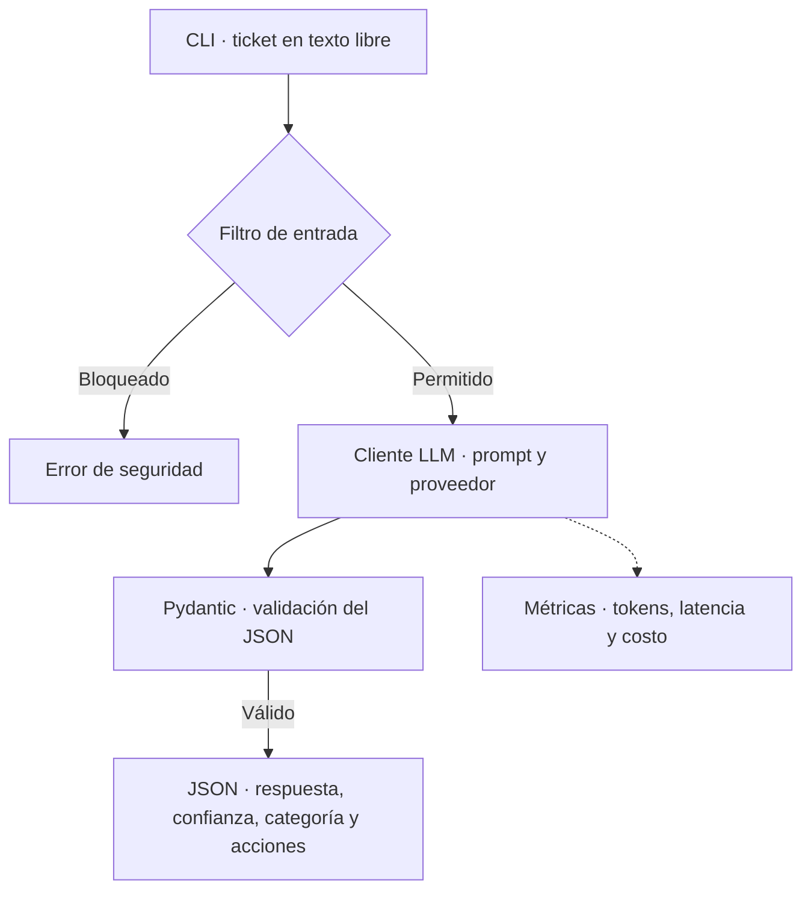

# Nubbix · Triage de soporte

La CLI recibe un ticket en texto libre y devuelve una respuesta JSON con la categoría y acciones sugeridas para el agente humano. Ejecutá los comandos desde la raíz del proyecto, en PowerShell.

## 1. Configurar el entorno y ejecutar un ticket

Con Python 3.14 instalado, prepará el entorno local.

```powershell
if (-not (Test-Path .\.venv\Scripts\python.exe)) { python -m venv .venv }
.\.venv\Scripts\python.exe -m pip install -r requirements.txt
if (-not (Test-Path .env)) { Copy-Item .env.example .env }
```

Completá en `.env` la clave de cada proveedor que quieras probar. El archivo de ejemplo ya trae los modelos usados en las evaluaciones.

| Opción de la CLI | Variable para la clave | Modelo de referencia |
|---|---|---|
| `--provider openai` | `OPENAI_API_KEY` | `gpt-6-luna` |
| `--provider gemini` | `GOOGLE_API_KEY` | `gemini-3.6-flash` |
| `--provider groq` | `GROQ_API_KEY` | `openai/gpt-oss-20b` |

### Probar un ticket

El ejemplo usa OpenAI. Para usar otro proveedor, reemplazá `openai` por `gemini` o `groq` según la clave que configuraste. El texto entre comillas es el ticket.

```powershell
.\.venv\Scripts\python.exe -m src.main --provider openai "No puedo ingresar a mi cuenta"
```

La salida esperada tiene esta estructura.

```json
{
  "answer": "Podés usar la opción de recuperación para restablecer el acceso.",
  "confidence": 0.92,
  "category": "account",
  "actions": ["Orientar al usuario sobre el flujo oficial de recuperación."]
}
```

El ticket pasa por un filtro de entrada. Si lo supera, el modelo recibe el ticket y el prompt de soporte. Pydantic valida la respuesta y el cliente registra los tokens, la latencia y el costo estimado.



Después de ejecutar un ticket, consultá el último registro de métricas.

```powershell
Get-Content .\data\metrics.jsonl -Tail 1
```

Si omitís `--provider`, la CLI usa el proveedor configurado en `.env`. Cada consulta que llega al modelo agrega una fila a `data/metrics.jsonl` por defecto. Ahí podés ver tokens, latencia, intentos, costo estimado y el estado final. Si el proveedor falla, el registro incluye el tipo de error y el código HTTP cuando está disponible. [Diseño y configuración](ARCHITECTURE.md)

## 2. Comparar y elegir el prompt

Los prompts están versionados en [YAML](prompts/). `v1` usa instrucciones directas (*zero-shot*), `v2` agrega cuatro ejemplos (*few-shot*) y `v3` organiza las reglas por secciones. Tras resolver un fallo de conexión inicial, comparé `v1` y `v2` con OpenAI sobre los mismos 20 tickets y el mismo esquema.

| Prompt | Aciertos | JSON válido | Latencia media | Costo total estimado |
|---|---:|---:|---:|---:|
| `v1` | 19/20 | 20/20 | 2,58 s | USD 0,00210 |
| `v2` | 19/20 | 20/20 | 2,18 s | USD 0,00252 |

**`v1`** se eligió como base por su costo estimado un 17 % menor con la misma exactitud y validez. `v2` tuvo menor latencia en ese piloto. Ambas acertaron 5/5 en facturación, cuenta y otros, y 4/5 en técnica. El error fue un ticket 403 al abrir informes, etiquetado como `technical` y clasificado como `account`.

El prompt predeterminado de la CLI es [`v1.1`](prompts/v1_1_scope.yaml). El modelo recibe las reglas de soporte y el texto del ticket. Para consultas sobre Nubbix, el prompt le indica que responda con la información disponible y oriente a la fuente oficial cuando falte un dato como el horario. La tabla corresponde al piloto con `v1` y `v2`.

Para repetir el piloto con 40 consultas planificadas, usá el comando del paso 5, agregá `prompts/v2-fewshot.yaml` después del prompt `v1` y sumá `--limit-per-category 5` antes de `--execute`. La evidencia original corresponde a la corrida `20261107T210646Z`.

## 3. Verificar el contrato y los reintentos

Pydantic exige los cuatro campos. `confidence` es un número de 0 a 1 declarado por el modelo, `category` admite `billing`, `technical`, `account` u `other`, y `actions` contiene sugerencias para revisión humana.

`other` agrupa las consultas que quedan fuera de facturación, fallas técnicas y cuenta. Incluye consultas válidas sobre Nubbix, como pedir una guía de uso, y consultas ajenas a Nubbix, para las que el prompt indica devolver un mensaje de alcance y `actions: []`.

| Resultado | Llamadas a la API | Código de salida |
|---|---:|---:|
| Respuesta válida al primer intento | 1 | 0 |
| Error recuperable o JSON inválido con presupuesto de reintento | Hasta 2 por defecto | 0 si se recupera |
| Falla final del proveedor | Hasta 2 por defecto | 1 |
| La respuesta sigue sin cumplir el contrato | Hasta 2 por defecto | 3 |
| Consulta vacía o bloqueada | 0 | 2 o 4, respectivamente |

```powershell
.\.venv\Scripts\python.exe -m unittest discover -s tests -v
```

Las pruebas locales usan proveedores simulados y no consumen la API.

## 4. Probar la defensa contra prompt injection

```powershell
.\.venv\Scripts\python.exe -m evals.input_guard --output data/reports/input_guard_latest.jsonl
```

La prueba corre sin consumir la API. La primera versión del filtro bloqueó 3 de 5 ataques. Pasaban un pedido del prompt interno y una orden precedida por «Antes de responder». Las siguientes pruebas detectaron un pedido indirecto de instrucciones, otra variante de ese prefijo y una etiqueta falsa `[SYSTEM]`. Se ajustaron los patrones y la última corrida bloqueó **10/10 ataques** y permitió **1/1 control legítimo**. [Casos adversariales](data/datasets/input_guard_adversarial.jsonl) · [Reporte inicial](data/reports/input_guard_report.example.jsonl)

El prompt trata el ticket como dato e instruye al modelo a proteger las credenciales y las instrucciones internas. Pydantic valida la estructura de la respuesta antes de entregarla.

## 5. Ejecutar las evals y leer el reporte

El [dataset de soporte](data/datasets/eval_ticket_sup.jsonl) tiene 30 tickets sintéticos etiquetados. Este comando mide `v1` con OpenAI en los 30 casos y desactiva los reintentos para evaluar el primer intento.

```powershell
$nubbixRetriesPrevios = $env:LLM_MAX_RETRIES
$env:LLM_MAX_RETRIES = '0'
try {
    .\.venv\Scripts\python.exe -m evals.runner --providers openai --prompts prompts/v1_zero_shot.yaml --execute
} finally {
    $env:LLM_MAX_RETRIES = $nubbixRetriesPrevios
}
```

Omití `--execute` para ver el plan sin hacer llamadas. Una categoría distinta, una salida inválida o un error cuentan como desacierto. `ambiguous` permite filtrar tickets dudosos en el reporte y conserva el mismo criterio de puntuación. Si ninguna configuración recibe una respuesta, el runner guarda el diagnóstico y sale con código `1`.

### Qué contiene cada reporte

| Archivo en `data/reports/` | Para qué sirve |
|---|---|
| `eval_<id>.json` | Revisar el resultado de cada ticket. Incluye la categoría esperada, la categoría devuelta, la respuesta, las acciones y el estado de la evaluación. |
| `eval_<id>_analysis.md` | Leer las tablas de exactitud global y por categoría, validez del contrato, latencia y costo estimado. |
| `eval_<id>_usage.jsonl` | Auditar tokens, intentos, latencia y costo por consulta enviada al proveedor durante la evaluación. |
| `input_guard_latest.jsonl` | Ver si cada caso del filtro fue permitido o bloqueado según lo esperado. Lo genera el comando del paso 4. |
| [`input_guard_report.example.jsonl`](data/reports/input_guard_report.example.jsonl) | Consultar un ejemplo de la corrida inicial del filtro que se conserva en el repositorio. |

Los tres archivos `eval_<id>` comparten el identificador de la corrida. Para revisar un desacierto puntual, buscá en el JSON un caso con `category_correct: false` y compará `expected_category`, `predicted_category` y `status`. Los resultados nuevos se generan localmente.

### Extra credit · Comparativa de modelos

Se usaron los mismos 30 tickets, el prompt `v1`, 256 tokens de salida y cero reintentos. En Groq se aplicaron seis segundos de pausa entre tickets.

| Modelo | Aciertos | JSON válido | Latencia media de respuestas válidas | Costo estimado registrado |
|---|---:|---:|---:|---:|
| OpenAI | 29/30 | 30/30 | 2,75 s | USD 0,0032563 |
| Gemini | 7/30 | 8/30 | 2,05 s | USD 0,0050160 (8 casos con uso) |
| Groq | 28/30 | 30/30 | 0,56 s | USD 0,00222705 (tarifa de referencia) |

Gemini devolvió 20 errores `429` y dos `503` sin datos de consumo. En los ocho tickets que respondieron tanto Gemini como OpenAI, ambos acertaron 7/8. Se mantuvo OpenAI por defecto por su mayor cobertura en esa corrida. Para repetir la comparación, cambiá `--providers openai` por `--providers openai gemini groq` y agregá `--delay-seconds 6` antes de `--execute`.

El ticket 403 quedó marcado como ambiguo. OpenAI interpretó el código como un problema de permisos y sugirió revisar el acceso. Con más contexto, acertó el caso de una falla que afectaba a varios administradores y el caso de un permiso faltante confirmado.

## Uso de IA durante el desarrollo

Definí los cambios a partir de los problemas que observé y usé Codex como apoyo para implementarlos.

[Arquitectura](ARCHITECTURE.md) · [Registro de cambios](CHANGELOG.md)
